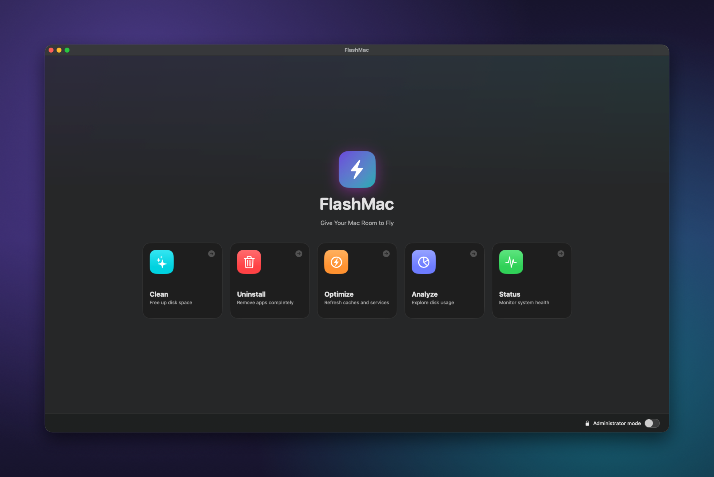
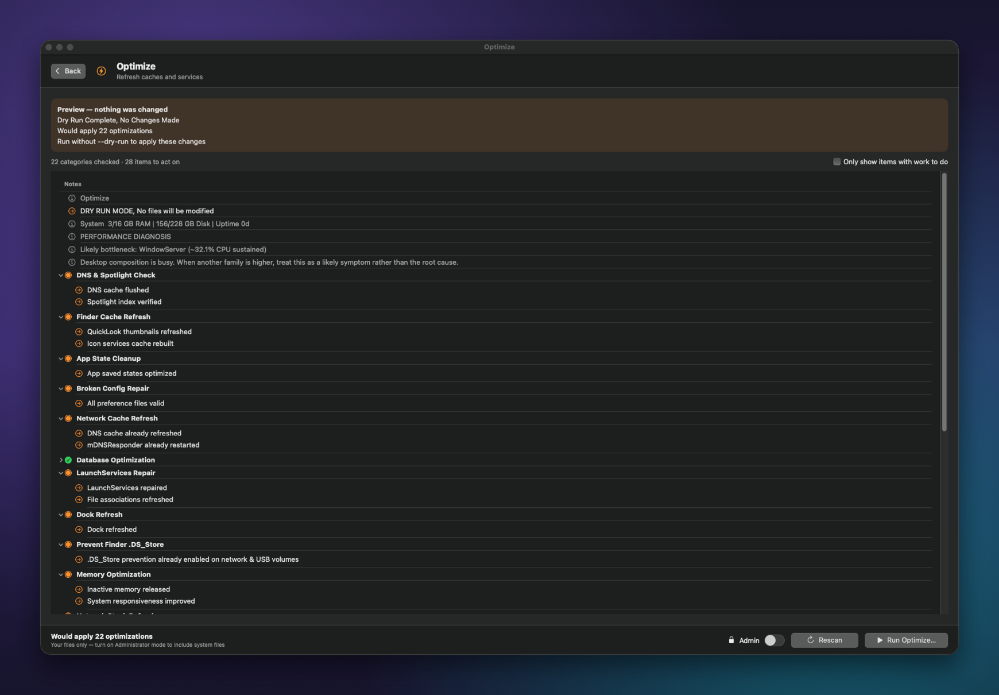
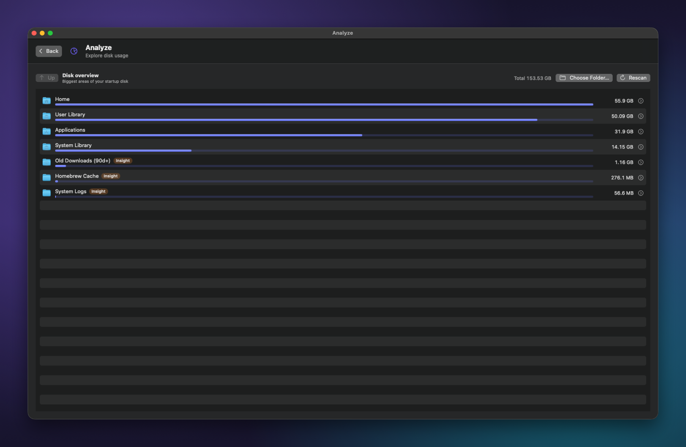
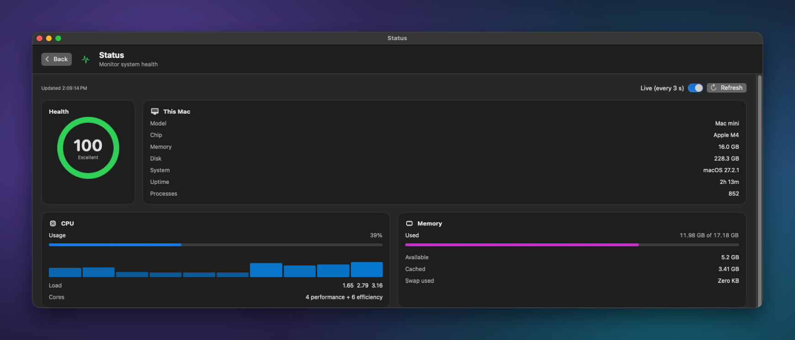

<div align="center">
  
  <h1>FlashMac</h1>
  <p><b>Give Your Mac Room to Fly.</b></p>
  <p>A free, native Mac app that cleans junk, removes apps completely, refreshes system services,<br/>shows what fills your disk and keeps an eye on your Mac's health. No Terminal, no subscription.</p>

  <a href="https://github.com/adilcursor/FlashMac/releases/latest"></a>
  <a href="https://github.com/adilcursor/FlashMac/releases"></a>
  
  
  <a href="LICENSE"></a>
  <a href="https://github.com/adilcursor/FlashMac/stargazers"></a>

  <br/><br/>
  <a href="https://github.com/adilcursor/FlashMac/releases/latest/download/FlashMac.zip"></a>
</div>

<p align="center">
  
</p>

## Why FlashMac

- 🧹 **Free up gigabytes** of caches, logs, temp files and leftovers from apps you deleted long ago
- 🗑️ **Uninstall apps completely**, including the hidden support files that dragging to the Trash leaves behind
- ⚡ **Refresh a sluggish Mac** by rebuilding DNS, Finder, LaunchServices and other system caches
- 📊 **See what is eating your disk**, folder by folder, with one click to reveal it in Finder
- 🩺 **Watch your Mac's health** with live CPU, memory, disk and network stats plus a health score
- 🛡️ **Safe by design**: every clean and uninstall shows a full preview, and nothing is deleted until you click

## Quick Start

1. **[Download FlashMac.zip](https://github.com/adilcursor/FlashMac/releases/latest/download/FlashMac.zip)** (about 5 MB).
2. Unzip it and drag **FlashMac.app** into your **Applications** folder.
3. The first time, **right-click FlashMac → Open**, then click **Open** again.

That's it. Everything FlashMac needs is built in, so there's nothing else to install.

<details>
<summary><strong>macOS says FlashMac "can't be opened" or "can't be verified"?</strong></summary>

<br/>

FlashMac is free and open source, and it isn't signed with a paid Apple Developer ID, so macOS asks you
to confirm the first launch. Either:

- right-click FlashMac in Applications → **Open** → **Open**, or
- open **System Settings → Privacy & Security**, scroll down and click **Open Anyway** next to FlashMac.

You only need to do this once.
</details>

## A Quick Tour

### 🧹 Clean
Scan first and see exactly what can go, grouped by category with sizes. When you're happy, click
**Clean Now** and confirm.

<p align="center"></p>

### 🗑️ Uninstall
Pick one or more apps, and FlashMac lists every file that belongs to them before anything happens.
Files go to the Trash by default, so you can change your mind.

### ⚡ Optimize
Preview every maintenance step, then run them all with one click.

<p align="center"></p>

### 📊 Analyze
Start from an overview of your disk and drill into any folder. Insights point out easy wins such as old
downloads and package-manager caches.

<p align="center"></p>

### 🩺 Status
A live dashboard of your Mac: health score, CPU per core, memory, disks, network and the busiest
processes.

<p align="center"></p>

## Safety First

- **Preview before every change.** Clean, Optimize and Uninstall always run a dry run first.
- **Deleting takes a click.** Pressing Return in a confirmation window cancels; only the red button deletes.
- **Trash by default.** Uninstalled apps go to the Trash unless you choose permanent deletion.
- **Protected paths.** Important caches (for example iCloud Drive, Spotlight and developer toolchains)
  are on a built-in whitelist and are never touched.
- **Administrator mode is opt-in.** Turn it on only if you want system-level files cleaned too. Your
  password is checked with `sudo`, kept in memory while FlashMac is open, and never saved.

## FAQ

<details>
<summary><strong>Is FlashMac really free?</strong></summary>
<br/>Yes. No ads, no subscription, no account, no tracking. The source code is right here under the MIT license.
</details>

<details>
<summary><strong>Which Macs does it support?</strong></summary>
<br/>Any Mac on macOS 14 Sonoma or newer, Apple Silicon or Intel. On Intel Macs, the Status and Analyze
screens need Mole installed (<code>brew install mole</code>); everything else works out of the box.
</details>

<details>
<summary><strong>Does it need the internet?</strong></summary>
<br/>No. FlashMac works offline, has no analytics or tracking, and keeps everything on your Mac.
</details>

<details>
<summary><strong>What is Administrator mode for?</strong></summary>
<br/>By default FlashMac only cleans files in your own user account. Administrator mode lets it also
clear system-wide caches, logs and temporary files, and remove apps that were installed by an
administrator (such as some Adobe apps).
</details>

<details>
<summary><strong>How do I update?</strong></summary>
<br/>Download the latest FlashMac.zip from <a href="https://github.com/adilcursor/FlashMac/releases/latest">Releases</a>
and replace the app in Applications. Click <b>Watch → Custom → Releases</b> on this page to be notified
about new versions.
</details>

<details>
<summary><strong>How do I remove FlashMac?</strong></summary>
<br/>Drag FlashMac from Applications to the Trash. It doesn't install anything else on your Mac.
</details>

## Build from Source

<details>
<summary><strong>Developer notes</strong></summary>

<br/>

Only Apple's Command Line Tools are needed (no Xcode):

```bash
xcode-select --install   # if you don't have the tools yet
brew install mole        # the build bundles your installed Mole engine into the app
Scripts/build.sh         # builds build/FlashMac.app + build/FlashMac.zip and installs to /Applications
```

`Scripts/build.sh --no-install` builds without installing. The app is SwiftUI with Swift Package Manager,
and drives the [Mole](https://github.com/tw93/mole) command-line engine:

| Screen    | Engine command(s)                                                         |
|-----------|---------------------------------------------------------------------------|
| Status    | `mo status --json`, refreshed every 3 s                                    |
| Analyze   | `mo analyze --json [path]`                                                 |
| Clean     | `mo clean --dry-run` preview → confirmation → `mo clean`                  |
| Optimize  | `mo optimize --dry-run` preview → confirmation → `mo optimize`            |
| Uninstall | `mo uninstall --list` → `--dry-run <apps>` → confirmation → `mo uninstall <apps>` |

Administrator mode runs the same commands through `sudo`. Developer launch arguments:
`--screen <clean|uninstall|optimize|analyze|status>`, `--back-after <sec>`, `--auto-preview` and
`--auto-plan "<app>"` (the last two only ever run dry runs). On the macOS 27 SDK `@State` is a macro whose
plugin ships only with Xcode, so the code uses `@LocalState` (`Sources/MoleApp/LocalState.swift`).

Marketing images are generated with `Scripts/make_marketing.swift`.
</details>

## Support FlashMac

If FlashMac helped your Mac breathe again, please **⭐ star this repo**. It helps other people find it.
Found a bug or have an idea? [Open an issue](https://github.com/adilcursor/FlashMac/issues).

## Credits & License

FlashMac is released under the [MIT License](LICENSE).

Its cleanup engine is [Mole](https://github.com/tw93/mole) by tw93. FlashMac bundles Mole 1.42.0, which is
MIT licensed; its license file ships inside the app at `FlashMac.app/Contents/Resources/mole/LICENSE`.

FlashMac deletes files when you confirm a clean or uninstall. Review the preview before you confirm.
The software is provided as is, without warranty.
