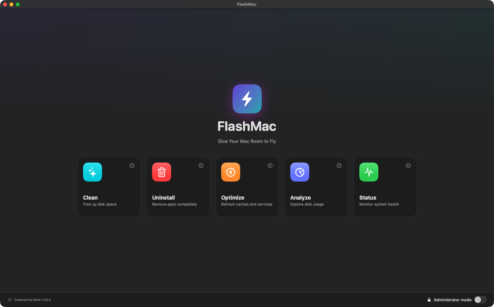
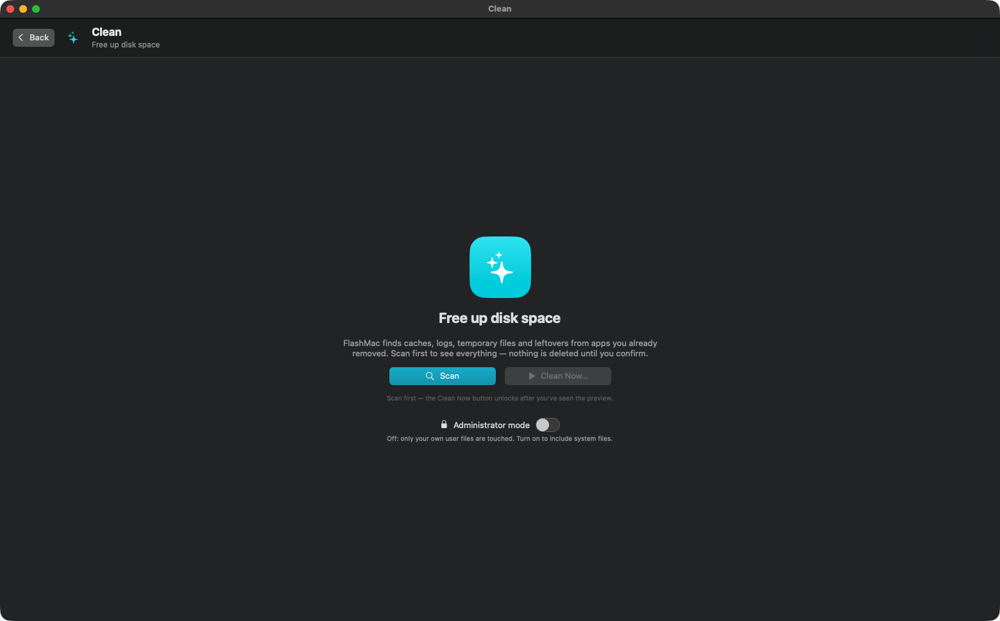

# FlashMac — Give Your Mac Room to Fly

FlashMac is a free, native Mac app that cleans and speeds up your Mac with a simple point-and-click
window. No Terminal needed.



Under the hood it uses [Mole](https://github.com/tw93/mole), a well-known open-source command-line
cleaner, and gives it a proper Mac interface with lists, previews and confirmation dialogs.

## Features

| | |
|---|---|
| **Clean** | Finds caches, logs, temporary files and leftovers from removed apps. Always shows a preview first. |
| **Uninstall** | Removes apps together with their hidden support files. Shows every file first; moves to Trash by default. |
| **Optimize** | Refreshes DNS, Finder and LaunchServices caches, repairs preferences and tidies system services. |
| **Analyze** | Shows what is using your disk, folder by folder. |
| **Status** | Live CPU, memory, disk, network and top processes, with a health score. |

**Administrator mode** (optional): turn it on to also clean system-level caches, logs and temporary
files. FlashMac asks for your Mac password, checks it with `sudo`, keeps it in memory only while the
app is open and never saves it.

Nothing is ever deleted without a preview and your confirmation.

| Clean | Analyze |
|---|---|
|  |  |

## Download and install

1. Download **FlashMac.zip** from the [latest release](../../releases/latest).
2. Unzip it and drag **FlashMac.app** into your **Applications** folder.
3. The first time, **right-click FlashMac → Open**, then click **Open** again.
   FlashMac isn't signed with a paid Apple Developer ID, so macOS asks once. If it still refuses, go to
   **System Settings → Privacy & Security** and click **Open Anyway**.

**Requirements:** macOS 14 Sonoma or newer, Apple Silicon or Intel.

Everything is included: FlashMac carries its own copy of Mole, so you don't need to install anything
else. If you already have Mole installed (`brew install mole`), FlashMac uses that instead.
On Intel Macs, the built-in copy's Status and Analyze helpers are Apple Silicon only; install Mole
with Homebrew to use those two screens.

## Build from source

Only Apple's Command Line Tools are needed (no Xcode):

```bash
xcode-select --install   # if you don't have the tools yet
brew install mole        # the build bundles your installed Mole into the app
Scripts/build.sh         # builds build/FlashMac.app + build/FlashMac.zip and installs to /Applications
```

Use `Scripts/build.sh --no-install` to build without installing.

### How it works

FlashMac runs the `mo` command and turns its output into native lists:

| Screen    | Command(s)                                                                 |
|-----------|----------------------------------------------------------------------------|
| Status    | `mo status --json`, refreshed every 3 s                                     |
| Analyze   | `mo analyze --json [path]`                                                  |
| Clean     | `mo clean --dry-run` preview → confirmation → `mo clean`                   |
| Optimize  | `mo optimize --dry-run` preview → confirmation → `mo optimize`             |
| Uninstall | `mo uninstall --list` → `mo uninstall --dry-run <apps>` → confirmation → `mo uninstall <apps>` |

In Administrator mode the same commands run through `sudo`.

Developer launch arguments: `--screen <clean|uninstall|optimize|analyze|status>`, `--back-after <sec>`,
`--auto-preview` (dry run only), `--auto-plan "<app>"` (dry run only).

Note for contributors: on the macOS 27 SDK, `@State` is a macro whose plugin ships only with Xcode, so
the code uses `@LocalState` (Sources/MoleApp/LocalState.swift) instead.

## Disclaimer

FlashMac deletes files when you confirm a clean or uninstall. Review the preview before you confirm.
The software is provided as is, without warranty (see [LICENSE](LICENSE)).

## Credits

- [Mole](https://github.com/tw93/mole) by tw93, MIT License — the cleanup engine. A copy is bundled
  inside the app together with its license.
- FlashMac is MIT licensed.
